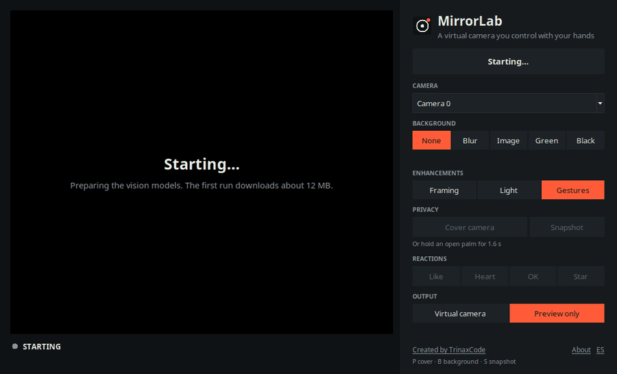
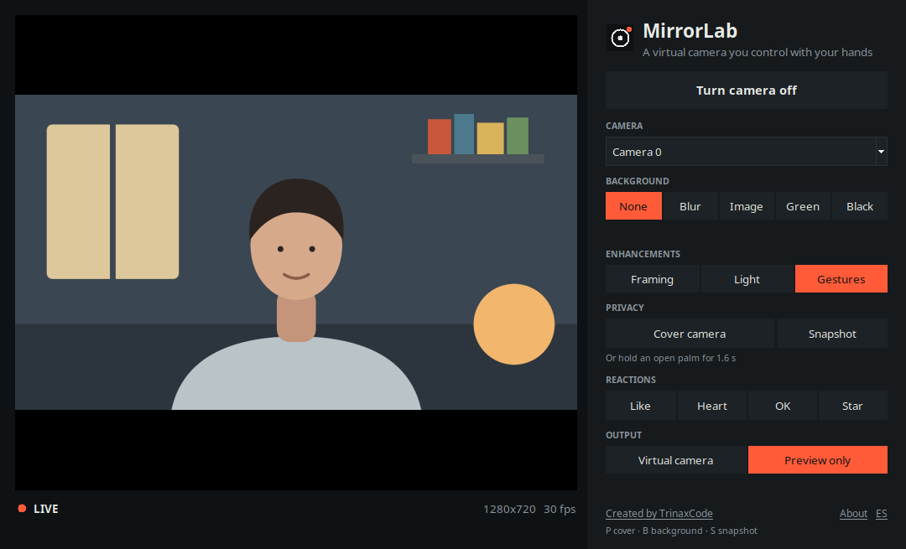

# MirrorLab

**A virtual camera for video calls, driven by your hands.** Background blur and replacement,
auto-framing, face-metered exposure and a privacy shutter, published as a camera that Zoom,
Meet, Teams, Discord, OBS and your browser can select. A desktop app for **Windows, macOS and
Linux** that runs on the CPU, on your machine.

[English](README.md) | [Español](README.es.md) | [Website](https://mirrorlabapp.web.app/en/) | [Download](https://github.com/TrinaxCode/mirrorlab/releases/latest)

[](https://github.com/TrinaxCode/mirrorlab/actions/workflows/ci.yml)
[](LICENSE)
[](pyproject.toml)
[](CHANGELOG.md)
[](https://github.com/TrinaxCode/mirrorlab/releases/latest)
[](#download)
[](https://mirrorlabapp.web.app/en/)

<p align="center">
  
</p>

```console
$ mirrorlab doctor                       # is this machine ready? tells you the exact fix if not
$ mirrorlab cam --profile meeting        # blur + auto-frame + studio light, published as a camera
$ mirrorlab ctl privacy                  # from another terminal or a hotkey: cover the camera
```

Hold up an open palm for 1.6 seconds and the camera is covered. Hold up a thumb and a
thumbs-up floats over your picture for the other people on the call. No mouse, no window to
find in the middle of a meeting.

---

## Download

Grab the installer for your system from the
[latest release](https://github.com/TrinaxCode/mirrorlab/releases/latest). Each release lists
the SHA-256 of every file in `SHA256SUMS.txt`.

| System | File | Notes |
| --- | --- | --- |
| **Windows 10+** (64-bit) | `MirrorLab-<version>-windows-setup.exe`, or `…-windows-portable.zip` | Install [OBS Studio](https://obsproject.com) so Zoom, Meet and Teams have a *OBS Virtual Camera* to pick. |
| **macOS 12+** (Apple silicon) | `MirrorLab-<version>-macos-arm64.dmg` | Not notarised yet: the first time, right-click the app and choose *Open*. Needs OBS 30+ for the camera. |
| **Linux** (Ubuntu 22.04+, x86-64) | `mirrorlab_<version>_amd64.deb`, or `MirrorLab-<version>-linux-x86_64.tar.gz` | For the virtual camera: `sudo apt install v4l2loopback-dkms`. |

Open **MirrorLab**, press *Turn camera on*, pick a background, and choose **MirrorLab** as the
camera in your call. If something is missing (a virtual camera driver, camera permission) the
app tells you what to do instead of failing silently.

<p align="center">
  
</p>

> **Licence of the binaries.** The installers bundle `pyvirtualcam` (GPL-2.0), so the
> **downloads are distributed under GPL-2.0**. The source code in this repository stays MIT,
> and the `vcam` extra remains opt-in if you install from source. Details in
> [THIRD_PARTY_LICENSES.md](THIRD_PARTY_LICENSES.md).

The app is also available as a command (see [docs/DESKTOP.md](docs/DESKTOP.md)): `mirrorlab desktop` (or `mirrorlab-studio`) opens the
same window from a source install.

---

## Why this exists

The usual ways to get these effects each cost you something: a platform-specific app
(NVIDIA Broadcast, Apple's Studio Light, Windows Studio Effects), an NVIDIA GPU, an OBS setup
with a plugin and a scene, or a Linux-only daemon. MirrorLab is the small, scriptable
version: one `pip install`, CPU only, the same command on all three systems, and a small codebase
you can read.

What it adds beyond blur is the **control surface**. In a meeting your hands are free and the
keyboard is not, so the effects are driven by hand gestures with a hold time (so a gesture
made in conversation does not trigger anything) and by a `ctl` command you can bind to any
hotkey.

It is not trying to out-polish the dedicated apps. The person mask comes from a small fast
model rather than a matting network, and on Windows and macOS you still need OBS installed to
provide the camera device. See [Limitations](#limitations).

---

## Install from source

Prefer the command line, or want to hack on it? Everything the app does is also a command.

```bash
git clone https://github.com/TrinaxCode/mirrorlab.git
cd mirrorlab
python3 -m venv .venv && source .venv/bin/activate      # Windows: .venv\Scripts\activate
pip install -e ".[vcam]"
mirrorlab doctor
```

`doctor` checks Python, OpenCV and MediaPipe, which models are cached, and whether a
virtual camera is available, and prints the exact command for anything missing. The first
run downloads about 12 MB of models.

> **Not on PyPI yet.** Install from source as above. The PyPI release is tracked in the
> [roadmap](ROADMAP.md).

The `vcam` extra installs [pyvirtualcam](https://github.com/letmaik/pyvirtualcam), which is
**GPL-2.0**, so it is opt-in and never pulled by default. Without it everything works except
the last step, publishing to a camera (`--output none` still lets you preview).

The operating system also needs a virtual camera device:

| System | One-time setup |
| --- | --- |
| **Linux** | `sudo apt install v4l2loopback-dkms` then `sudo modprobe v4l2loopback devices=1 video_nr=10 card_label="MirrorLab" exclusive_caps=1` |
| **macOS** | Install [OBS Studio](https://obsproject.com) 30+, click *Start Virtual Camera* then *Stop Virtual Camera* once, quit OBS. |
| **Windows** | Install [OBS Studio](https://obsproject.com) (it provides the *OBS Virtual Camera*). |

Full per-platform instructions, including camera permissions, are in
[docs/STUDIO.md](docs/STUDIO.md#setting-up-a-virtual-camera).

### Known-good dependency pins

If a MediaPipe or NumPy version misbehaves on your machine, this combination is the tested
fallback (MediaPipe 1.0.1 aborts inside Apple's Metal helper on some macOS builds):

```bash
pip install "mediapipe>=0.10.9,<0.11" "numpy<2" "opencv-python<5"
```

Details in [docs/CROSS_PLATFORM.md](docs/CROSS_PLATFORM.md#the-dependency-pins).

---

## Use

```bash
mirrorlab cam --profile meeting                       # blur + auto-frame + studio light
mirrorlab cam --background replace --bg-image office.jpg
mirrorlab cam --background green --studio-light       # chroma key for OBS
mirrorlab cam --privacy-on-start                      # start covered; a palm opens it
mirrorlab cam --away-after 10                         # cover after 10 s with nobody in frame
mirrorlab cam --output none --preview                 # try it with no virtual camera installed
```

Then, from anywhere:

```bash
mirrorlab ctl status
mirrorlab ctl privacy              # toggle the shutter
mirrorlab ctl background blur
mirrorlab ctl react love
```

Settings live in an optional `studio.json`; profiles (`meeting`, `stream`, `privacy`,
`clean`, or your own) bundle them. Every key is documented in
[docs/STUDIO.md](docs/STUDIO.md#settings), and unknown keys are an error rather than being
silently ignored.

### What you get

| | |
| --- | --- |
| **Background** | `blur`, `replace` (your image), `green` or `black`, with a temporally smoothed mask so the outline does not shimmer |
| **Auto-framing** | Smooth virtual pan and zoom that keeps your face in the upper third; deadzone, bounded zoom, eases back when you leave |
| **Studio light** | Exposure metered on your face rather than the room, so a bright window does not leave you dark |
| **Privacy shutter** | On demand, by gesture, or automatically when you leave the frame |
| **Reactions** | Thumbs-up, heart and OK icons float over the picture, triggered by hand gestures |
| **Gestures** | Hold-to-confirm hand poses mapped to any of the actions above |

### Default gestures

| Gesture | Action | Hold |
| --- | --- | --- |
| Open palm | toggle the privacy shutter | 1.6 s |
| Peace sign | next background | 1.0 s |
| Thumbs up | thumbs-up reaction | 0.6 s |
| I-love-you | heart reaction | 0.6 s |
| OK | OK reaction | 0.6 s |

All of it is remappable in the settings file. How recognition and the hold-to-confirm
logic work is in [docs/GESTURES.md](docs/GESTURES.md).

---

## What it guarantees about your privacy

These are written as properties the code keeps and the tests check
([details](docs/STUDIO.md#privacy-model)):

- **Nothing leaves the machine.** The only network access is the one-time model download.
- **Background effects fail closed.** If the person mask is unavailable, the whole frame is
  blurred. Your room is never passed through while you believe it is hidden.
- **A closed shutter shows no camera pixels** (in the default `card` and `black` modes).
- **A lost camera never freezes on your last picture.** After 1.5 s without frames the output
  becomes the cover, and the session retries the camera.
- **The control channel is local and authenticated:** loopback only, a random token in a
  file only you can read, and a line protocol a web page cannot speak.

---

## Performance

Output rate and per-frame cost at 1280x720, on an AMD Ryzen 7 5700U laptop (Python 3.12)
that was also running a desktop, a browser and an editor. Three runs of 400 frames each on a
fixed input; the 30 fps budget is 33 ms per frame.

| Configuration | Output | Frame time p50 / p95 |
| --- | --- | --- |
| `--profile meeting` (blur, framing, light, gestures) | 29.9 fps | 23 ms / 29-33 ms |
| `--profile meeting --no-gestures` | 29.9 fps | 23 ms / 29 ms |
| `--profile clean` (passthrough) | 30.0 fps | 2.7 ms / 4 ms |

Measure yours with the command in [docs/STUDIO.md](docs/STUDIO.md#performance), which also
lists what to turn down on a slower machine.

---

## Limitations

Things that are true today, so you do not find out in a meeting:

- **The macOS build is Apple silicon only and is not notarised**, and the Windows and macOS
  installers are produced and smoke-tested by CI rather than by hand on every release.
- **Windows and macOS need OBS installed** to provide the camera device. That is a limit of
  the underlying library, not something MirrorLab can remove.
- **The virtual-camera output is tested with mocks and, for everything before it, with a real
  camera; it is not exercised against a real `v4l2loopback` or OBS device in CI.** If it fails
  on your setup, `mirrorlab doctor` output in an issue is the fastest route to a fix.
- **The mask is from a small model.** MediaPipe's selfie segmenter is fast and good for a
  head-and-shoulders view. Fast hand movement and hair can show a halo at the edge.
- **Auto-framing is a digital crop**, so zooming in costs resolution. `max_zoom` bounds it.
- **No audio.** Microphone noise suppression is a different problem and out of scope.
- **Gestures need a visible hand and decent light.** If your CPU is weak, `--no-gestures`
  and `mirrorlab ctl` give the same control without hand tracking.

---

## Also in this repository

**The playground** (`mirrorlab play`) is the original MirrorLab: a live window with 54
chainable video filters, 15 AR effects, 18 facial expressions and 22 hand gestures. It shares
the perception code with the studio and is documented in
[docs/PLAYGROUND.md](docs/PLAYGROUND.md). **The browser demo** in [`web/`](web/) runs a
subset of the same ideas client-side, at
[mirrorlabapp.web.app](https://mirrorlabapp.web.app/en/) (Firebase Hosting; English at `/en/`,
Spanish at `/`). Analytics are off until you accept them.

---

## Development

```bash
make install        # venv + dev extras
make check          # ruff, black, mypy on the studio package, and the tests
```

The test suite needs no camera and no network. Studio logic is tested with fake detectors;
a small set of tests (`-m slow`) runs the real MediaPipe models on a real photograph and
skips itself when the models are unavailable. CONTRIBUTING.md has the conventions, and
[docs/STUDIO.md](docs/STUDIO.md#how-a-frame-is-processed) has the code map.

To build the installers yourself, see [packaging/README.md](packaging/README.md).

```
src/mirrorlab/
├── desktop/       the Tkinter app: window, runner thread, preferences, self-test
├── studio/        the virtual camera: settings, state, pipeline, effects, control, session
├── detectors/     MediaPipe face / hand / segmentation behind a fallback ladder
├── gestures.py    22 hand gestures from explainable geometric rules
├── actions.py     gesture → action with majority vote, hold time and release
├── camera.py      capture backends per OS, threaded drop-latest reader
├── filters/ effects/ render/ app.py     the playground
└── cli.py         `mirrorlab` command
```

---

## Roadmap

See [ROADMAP.md](ROADMAP.md): what is done, what is next (PyPI release, a real
`v4l2loopback` integration test, calibrated gestures), and what is deliberately not planned.

## Community

MirrorLab is open source in the full sense: the code is MIT, the development is in the open,
and decisions are written down.

- **Contribute:** [CONTRIBUTING.md](CONTRIBUTING.md) covers setup, tests and the pull request
  checklist; [good first issues](https://github.com/TrinaxCode/mirrorlab/labels/good%20first%20issue)
  are a friendly start. Wording fixes and translations ([docs/TRANSLATING.md](docs/TRANSLATING.md)) are welcome.
- **Ask or show:** [Discussions](https://github.com/TrinaxCode/mirrorlab/discussions). More in [SUPPORT.md](SUPPORT.md).
- **How decisions are made:** [GOVERNANCE.md](GOVERNANCE.md) and the [decision records](docs/adr/).
- **Trust the download:** every release has `SHA256SUMS.txt` and build provenance
  (`gh attestation verify <file> --repo TrinaxCode/mirrorlab`); see [docs/RELEASING.md](docs/RELEASING.md).
- **Security:** report privately through [SECURITY.md](SECURITY.md).

## Credits and licences

MirrorLab's code is **MIT**. It is built on [MediaPipe](https://ai.google.dev/edge/mediapipe)
(Apache-2.0), [OpenCV](https://opencv.org/) (Apache-2.0) and [NumPy](https://numpy.org/)
(BSD-3). The face, hand and segmentation models are **downloaded at runtime, never
redistributed**, and keep their publishers' terms. `pyvirtualcam` (GPL-2.0) is an optional
extra you install yourself. The full inventory is in
[THIRD_PARTY_LICENSES.md](THIRD_PARTY_LICENSES.md).

Cite via [CITATION.cff](CITATION.cff). Security reports go through
[SECURITY.md](SECURITY.md). Contributions: [CONTRIBUTING.md](CONTRIBUTING.md) and the
[Code of Conduct](CODE_OF_CONDUCT.md).

---

<p align="center">
  Created by <a href="https://github.com/TrinaxCode"><strong>TrinaxCode</strong></a>
  (Huascar Ignacio D Trinidad Arguello) · <a href="https://github.com/TrinaxCode/mirrorlab">github.com/TrinaxCode/mirrorlab</a>
</p>

Source code MIT © 2026 TrinaxCode. Packaged binaries GPL-2.0 (they include pyvirtualcam).
