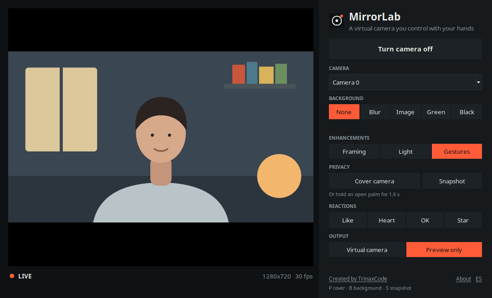

# The desktop app

> [English](DESKTOP.md) · [README](../README.md) · [Studio guide](STUDIO.md) · [Packaging](../packaging/README.md)

The desktop app is a window around the same pipeline `mirrorlab cam` runs: a live preview on
the left, every control on the right. Install it from the
[latest release](https://github.com/TrinaxCode/mirrorlab/releases/latest), or run
`mirrorlab desktop` (also `mirrorlab-studio`) from a source install.



## Controls

| Section | What it does |
| --- | --- |
| **Turn camera on / off** | Starts or stops capture and the pipeline. Nothing runs while it is off. |
| **Camera** | Picks the capture device. |
| **Background** | None, blur, your own image, green screen or black. |
| **Enhancements** | Auto-framing, studio light, hand gestures. |
| **Privacy** | Cover or uncover the camera, take a snapshot. An open palm held for 1.6 s does the same as *Cover camera*. |
| **Reactions** | Float a thumbs-up, heart, OK or star over the picture. |
| **Output** | *Virtual camera* publishes to the system camera device; *Preview only* just shows the window. |

Keyboard: `P` cover, `B` next background, `S` snapshot. The language (Spanish or English)
follows the system and can be switched in the window; preferences are remembered.

## How it works

`desktop/runner.py` runs a `StudioSession` on a worker thread. The session calls a
`frame_callback` with each processed frame, the window converts it to a PPM and shows it with
`tk.PhotoImage` (no Pillow needed), and every button sends the same action the CLI's
`mirrorlab ctl` sends. Closing the window, or turning the camera off, stops the thread and
releases the camera and the virtual device.

If the virtual camera driver is missing, or the camera is busy or has no permission, the app
shows the reason and the fix in the window instead of failing silently. *Preview only* always
works.

## Files

| Path | What it is |
| --- | --- |
| `src/mirrorlab/desktop/window.py` | The Tkinter window and its controls |
| `src/mirrorlab/desktop/runner.py` | The worker thread around `StudioSession` |
| `src/mirrorlab/desktop/prefs.py` | Preferences, stored as JSON in the user's config folder |
| `src/mirrorlab/desktop/strings.py` | Spanish and English text |
| `src/mirrorlab/desktop/selftest.py` | `--self-test`, used by CI on the frozen app |

## Making the screenshots and GIF

```bash
python scripts/media/record_desktop.py --lang en     # needs a display; writes docs/media/
```

It feeds the app a drawn scene, so the pictures contain nobody's face. Use `--camera 0` to
record with your own webcam.
