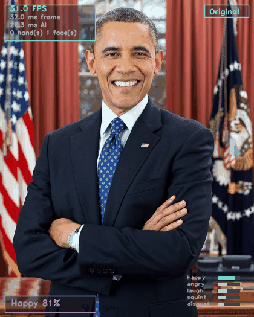
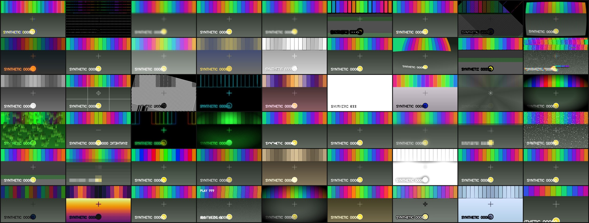

# MirrorLab Playground

> [README](../README.md) · [Studio](STUDIO.md) · [Gestures](GESTURES.md) · [Filters](FILTERS.md) · [Expressions](EXPRESSIONS.md) · [FAQ](FAQ.md)

The playground is the original MirrorLab application: a live window with 54 chainable video
filters, 15 procedural AR effects, 18 facial expressions read from blendshapes, 22 hand
gestures, air drawing and a recorder. It shares the face and hand engine with the
[Studio](STUDIO.md) but is a separate program, started with `mirrorlab play`.

It is kept as a place to try the perception stack and to build new filters and gestures.
If you want a virtual camera for video calls, you want [`mirrorlab cam`](STUDIO.md).

## Demo



*Every frame above comes from the real pipeline — the face is detected, the expression is read
from blendshapes, the sunglasses and crown are anchored to the eye line, and the HUD is the
one you get at runtime. Regenerate it yourself with `mirrorlab gallery` for a still contact
sheet of all 54 filters.*

**Or skip the install entirely:** **[mirrorlab-demo.vercel.app](https://mirrorlab-demo.vercel.app)**
runs the same perception ideas in your browser with WebAssembly and WebGL. Your camera stream
never leaves the page.

### Gallery



*All 54 filters, rendered by `mirrorlab gallery`.*

---


---

## Usage

### Common commands

```bash
mirrorlab                                  # run with defaults (same as `mirrorlab play`)
mirrorlab play --filter cartoon+vignette    # chain filters with `+`
mirrorlab play --preset noir                # a curated multi-filter look
mirrorlab play --effect sunglasses --effect fire
mirrorlab play --no-hands                   # faster: skip hand tracking
mirrorlab play --segment                    # enable the person mask (background blur/replace)

mirrorlab filters                          # list all 54, grouped by category
mirrorlab filters --category artistic      # one category
mirrorlab filters --presets                # the 10 curated presets
mirrorlab gestures                         # every gesture and its bound action
mirrorlab expressions                      # every detectable expression
mirrorlab effects                          # every AR effect

mirrorlab doctor                           # is this machine ready?
mirrorlab cameras --max-index 5            # which indices and backends deliver frames
mirrorlab models --status                  # what is in the model cache
mirrorlab models --download                 # fetch any missing model bundles
mirrorlab benchmark --all --frames 30      # ms/frame for all 54 filters
mirrorlab config --list                    # every config key and its default
mirrorlab config --init mirrorlab.json     # write a config file you can edit
mirrorlab gallery --output assets/filter-gallery.png   # contact sheet of all filters
mirrorlab demo --frames 120                # offline, synthetic source, no camera
```

`mirrorlab` with no arguments is `mirrorlab play`. Every subcommand supports `--help`, and
most support `--json` for machine-readable output — which is what the website's catalog
generator consumes.

### Configuration

Configuration resolves in four layers, lowest priority first: built-in defaults → a config
file (`mirrorlab.json` / `mirrorlab.yaml`, discovered in the current directory or
`~/.config/mirrorlab`) → `MIRRORLAB_*` environment variables → CLI flags. Unknown keys are a
hard error with a pointer to `mirrorlab config --list`, so a typo never silently does
nothing.

```bash
MIRRORLAB_FILTER="cartoon+vignette" MIRRORLAB_THEME=magma mirrorlab play
MIRRORLAB_SMOOTHING_MIN_CUTOFF=1.0 mirrorlab play      # smoother landmarks
```

Every key, with its type and default:

#### Camera

| Key | Type | Default | Description |
| --- | --- | --- | --- |
| `camera_index` | int | `0` | Camera device index (`--camera`, `-c`) |
| `camera_width` | int | `1280` | Requested capture width (`--camera-width`); lower it for speed |
| `camera_height` | int | `720` | Requested capture height (`--camera-height`) |
| `camera_fps` | int | `30` | Requested capture frame rate, 1–240 (`--camera-fps`) |
| `camera_backend` | str | `"auto"` | `auto`, `avfoundation`, `dshow`, `msmf`, `v4l2` or `any` (`--backend`) |
| `mirror` | bool | `true` | Flip horizontally so the preview behaves like a mirror (`--no-mirror`) |

#### Detectors

| Key | Type | Default | Description |
| --- | --- | --- | --- |
| `enable_face` | bool | `true` | Face detection and expression recognition (`--no-face`) |
| `enable_hands` | bool | `true` | Hand tracking and gestures. Needs MediaPipe (`--hand` / `--no-hands`) |
| `enable_segmentation` | bool | `false` | Person mask for `bg_blur`, `bg_replace`, `privacy` (`--segment`) |
| `max_faces` | int | `1` | Maximum faces to track (`--max-faces`) |
| `max_hands` | int | `2` | Maximum hands to track (`--max-hands`) |
| `min_face_confidence` | float | `0.5` | Face detection threshold, 0–1 |
| `min_hand_confidence` | float | `0.5` | Hand detection threshold, 0–1 |
| `min_tracking_confidence` | float | `0.5` | Tracking threshold for both models, 0–1 |
| `model_complexity` | int | `1` | `0` = fastest, `1` = balanced. Applies to the legacy Solutions hand backend; the Tasks bundle is fixed |

#### Pipeline

| Key | Type | Default | Description |
| --- | --- | --- | --- |
| `filter` | str | `"original"` | Filter or `+`-chain, e.g. `cartoon+vignette+glitch` (`--filter`, `-f`) |
| `effects` | list | `[]` | AR effect names, e.g. `["sunglasses","dog"]` (`--effect`, repeatable) |
| `gesture_control` | bool | `true` | Let gestures trigger actions (`--no-gesture-control` detects without acting) |
| `air_draw` | bool | `false` | Start with air-draw enabled (`--air-draw`). Also toggled at runtime with `d`, `i` or the ☝️ `pointing` gesture |
| `smooth_landmarks` | bool | `true` | One-Euro landmark smoothing. Off also disables expression EMA |
| `smoothing_min_cutoff` | float | `1.7` | One-Euro cutoff at rest: lower = smoother, slightly laggier |
| `smoothing_beta` | float | `0.35` | One-Euro speed coefficient: higher = more responsive to fast motion |
| `expression_smoothing` | float | `0.35` | EMA weight for expression scores, 0–1; `0` disables smoothing |

#### Window and HUD

| Key | Type | Default | Description |
| --- | --- | --- | --- |
| `window_name` | str | `"MirrorLab"` | Preview window title |
| `window_width` | int | `1280` | Preview window width |
| `window_height` | int | `720` | Preview window height |
| `fullscreen` | bool | `false` | Start fullscreen (`--fullscreen`) |
| `show_hud` | bool | `true` | Draw the HUD panels and badges (`--no-hud`, or `h`) |
| `show_landmarks` | bool | `true` | Draw the face mesh and hand skeletons (`--no-landmarks`, or `l`) |
| `show_fps` | bool | `true` | Draw the FPS / frame-time / inference-time panel |
| `reactions_dir` | str | `"assets/reactions"` | Directory searched for reaction images (`happy.png`, `sad.png`, …). Missing files are fine |
| `show_reactions` | bool | `false` | Show a reaction image per expression (`--reactions`, toggled at runtime with `i`) |

#### Output

| Key | Type | Default | Description |
| --- | --- | --- | --- |
| `output_dir` | str | `"captures"` | Directory for snapshots and recordings (`--output`) |
| `record_fps` | float | `30.0` | Frame rate written to recordings |
| `record_codec` | str | `"mp4v"` | FourCC for the video writer (`--record-codec`); falls back to `XVID`, then `MJPG` |
| `snapshot_format` | str | `"png"` | `png`, `jpg`, `jpeg` or `webp` |
| `jpeg_quality` | int | `95` | Quality for lossy snapshot formats |

#### Runtime

| Key | Type | Default | Description |
| --- | --- | --- | --- |
| `headless` | bool | `false` | No preview window; for servers, CI and batch runs (`--headless`) |
| `max_frames` | int | `0` | Stop after N frames; `0` = unlimited (`--frames`) |
| `stats_csv` | str | `""` | Append per-frame statistics to this CSV; empty = disabled (`--stats-csv`) |
| `log_level` | str | `"INFO"` | Logging level. `--verbose` / `-v` overrides it for one run |
| `theme` | str | `"aurora"` | HUD palette: `aurora`, `magma`, `mono` or `candy` (`--theme`, or `t` at runtime) |

### Filters

54 filters in six categories. Pass one with `--filter`, or chain them with `+`:
`--filter cartoon+vignette+glitch`. The CLI token is the name in the first column.

`cost` is a rough guide — `cheap` is under 2 ms at 640×480, `medium` up to ~20 ms, `heavy` above that. Measured numbers are in [Performance](#performance).

<details>
<summary><b>🎛️ Basic — 9 filters</b></summary>

| Name | Emoji | Description |
| --- | --- | --- |
| `original` | 🎥 | The untouched camera feed |
| `grayscale` | ⚫ | Luminance-only rendering with a slight contrast lift |
| `sepia` | 🟤 | Warm antique tone via a fixed colour matrix |
| `invert` | 🔳 | Photographic negative |
| `posterize` | 🧱 | Quantises each channel to a few flat levels — a screen-print look |
| `sharpen` | 🔪 | Unsharp mask that lifts local detail without halos |
| `blur` | 💧 | Gaussian dream blur |
| `vignette` | ⭕ | Darkened corners that pull the eye to the centre of frame |
| `emboss` | 🗿 | Bas-relief edge shading that makes the image look carved |

</details>

<details>
<summary><b>🌈 Colour — 6 filters</b></summary>

| Name | Emoji | Description |
| --- | --- | --- |
| `warmth` | 🌅 | Warm, slightly lifted shadows — flattering on every skin tone |
| `saturation` | 🎨 | Punchy saturation boost in HSV space |
| `duotone` | 🎭 | Maps luminance onto a two-colour ramp |
| `cyberpunk` | 🌆 | Teal shadows, orange highlights and a neon bloom |
| `infrared` | 🩻 | Aerochrome-style false colour: foliage glows pink, skin goes porcelain |
| `lomo` | 📷 | Saturated toy-camera look with crushed blacks and heavy vignette |

</details>

<details>
<summary><b>🖌️ Artistic — 13 filters</b></summary>

| Name | Emoji | Description |
| --- | --- | --- |
| `cartoon` | 🖍️ | Flat colour regions plus bold ink outlines — the classic cel look |
| `sketch` | ✏️ | Dodge-blend graphite drawing with an optional colour wash |
| `ink` | 🖊️ | High-contrast line art, like a brush pen drawing |
| `oil` | 🖼️ | Histogram-based brush strokes: each pixel takes the dominant colour of its neighbourhood |
| `watercolor` | 🎐 | Soft washes with paper-like edges and lifted highlights |
| `halftone` | 🔵 | Newspaper dot screen, generated with a rotated dot lattice |
| `ascii` | 🔤 | Renders the frame as text glyphs — yes, in real time |
| `pixelate` | 🟦 | Chunky 8-bit mosaic, with an animated block size option |
| `glass` | 🪟 | Colour cells separated by dark lead lines |
| `pointillism` | 🔴 | Seurat-style dots of pure colour that blend in your eye |
| `kaleidoscope` | 🔮 | Mirrors the frame into N rotating wedges — pure wallpaper material |
| `fisheye` | 🐟 | Barrel distortion straight out of a skate video |
| `comic` | 💥 | Ben-Day dots, halftone gradients and heavy ink — a printed page |

</details>

<details>
<summary><b>✨ Stylised — 9 filters</b></summary>

| Name | Emoji | Description |
| --- | --- | --- |
| `neon` | 💡 | Edges only, blooming in electric colour over black |
| `thermal` | 🌡️ | False-colour heat map driven by inverted luminance |
| `night_vision` | 🌙 | Gen-II image intensifier: green phosphor, gain noise and a soft bloom |
| `xray` | 🦴 | Inverted radiograph with bone-bright edges |
| `hologram` | 🔷 | Cyan wireframe projection with scanline flicker and a glitch bar |
| `dream` | ☁️ | Soft-focus bloom with lifted blacks and pastel colour |
| `orton` | 🌤️ | Landscape photographer's glow: blurred copy at 50 % screen |
| `solarize` | 🔆 | Sabattier effect: tones past the midpoint invert |
| `anaglyph` | 🕶️ | Red/cyan stereo split — grab some cardboard glasses |

</details>

<details>
<summary><b>📺 Glitch &amp; retro — 9 filters</b></summary>

| Name | Emoji | Description |
| --- | --- | --- |
| `glitch` | ⚡ | Databend-style block displacement, RGB shear and dropout noise |
| `chromatic` | 🔴 | Lens-style radial colour fringing, strongest at the edges |
| `vhs` | 📼 | Tracking noise, colour bleed, tape wobble and a timecode stamp |
| `crt` | 🖥️ | Aperture-grille subpixels, scanlines, barrel glass and a rolling bar |
| `datamosh` | 🧬 | Motion vectors smear the previous frame's pixels — broken P-frames |
| `scanlines` | 〰️ | Subtle interlacing plus a light horizontal drift |
| `trails` | 👻 | Feedback delay that leaves ghosts of everything that moves |
| `matrix` | 🟩 | Falling katakana columns composited over a green-tinted feed |
| `slitscan` | 🌌 | Each frame contributes one column — time becomes space |

</details>

<details>
<summary><b>🛠️ Utility — 8 filters</b></summary>

| Name | Emoji | Description |
| --- | --- | --- |
| `bg_blur` | 🌀 | Portrait-mode separation. Needs `--segment` to build the person mask |
| `bg_replace` | 🏞️ | Swaps the background for a gradient or a solid colour. Needs `--segment` |
| `privacy` | 🕵️ | Blurs the background so only you are readable — safe screen sharing |
| `face_crop` | 🙂 | Keeps your face centred and correctly sized in frame |
| `skin_smooth` | 🧖 | Frequency-separation retouching: softens texture, keeps detail |
| `mirror` | 🪞 | Mirrors the left half onto the right — instant symmetry |
| `zoom` | 🔍 | Digital zoom with a smooth breathing motion |
| `grid` | 📐 | Composition guides for framing a shot |

</details>

Every filter's algorithm — the actual OpenCV calls and formulas — is documented in
[docs/FILTERS.md](FILTERS.md).

### Presets

A preset is a tuned filter chain behind one name. `[` and `]` cycle them at runtime, and
`swipe_up` / `swipe_down` do the same by gesture.

| Preset | Chain | Look |
| --- | --- | --- |
| `cinema` | `warmth+vignette+sharpen` | Warm highlights, soft corners, crisp detail |
| `anime` | `cartoon+saturation` | Flat cel colours with a vivid palette |
| `noir` | `grayscale+vignette+sharpen` | High-contrast monochrome with a heavy vignette |
| `retro80s` | `cyberpunk+chromatic+scanlines` | Neon grade, colour fringing and CRT lines |
| `broken` | `glitch+trails` | Databend blocks with echo trails |
| `toon` | `comic+halftone` | Ben-Day dots and heavy ink |
| `ghost` | `xray+glitch` | Radiograph look with signal dropouts |
| `studio` | `skin_smooth+warmth+bg_blur` | Retouched skin, warm light, blurred background (needs `--segment`) |
| `paper` | `sketch+saturation` | Graphite linework with a colour wash |
| `vhs` | `vhs+scanlines` | Tape wobble, tracking noise and scanlines |

```bash
mirrorlab play --preset noir
mirrorlab play --preset studio --segment
mirrorlab filters --presets
```

### AR effects

15 effects, passed with `--effect` (repeatable): `mirrorlab play --effect sunglasses --effect fire`.
Face effects are anchored to the eye line, so they scale with the inter-ocular distance and
rotate with head roll. Everything is drawn procedurally with OpenCV primitives — no PNG
assets, no binary artwork in the repository.

**Face effects (11)**

| Name | Emoji | Description |
| --- | --- | --- |
| `sunglasses` | 🕶️ | Wayfarers locked to the eye line — tilt your head and they follow |
| `laser_eyes` | 🔴 | Twin beams from your irises, with an animated flicker |
| `dog` | 🐶 | Flappy ears, a boopable nose and a tongue that tracks your jaw |
| `crown` | 👑 | A gold crown, because you are the main character |
| `halo` | 😇 | A floating ring of light that bobs above your head |
| `mustache` | 🥸 | A handlebar mustache anchored to your upper lip |
| `blush` | 😊 | Soft rosy cheeks that intensify when you smile |
| `visor` | 🤖 | A scanning HUD bar across your eyes, with a live readout |
| `mask` | 😷 | A surgical mask fitted to your face oval |
| `big_eyes` | 👀 | Local lens warp that enlarges both eyes — anime mode |
| `googly` | 🙃 | Two wobbling paper eyes stuck over yours |

**Hand effects (4)**

| Name | Emoji | Description |
| --- | --- | --- |
| `trails` | 🌈 | Glowing ribbons that follow your fingertips and fade out |
| `fire` | 🔥 | Flames rising off every fingertip, brighter when you spread your hand |
| `sparkles` | ✨ | A four-point star twinkles at each fingertip |
| `skeleton` | 🦾 | Draws the 21-point skeleton with joint dots and a bone glow |

Two of them react to what your face is doing: `dog` grows its tongue with `jawOpen`, and
`blush` intensifies with `mouthSmile`. Effects that react to expressions feel alive; static
stickers do not.

---

## Keyboard and gesture shortcuts

### Keyboard

| Key | Action |
| --- | --- |
| `q` / `Q` | Quit |
| `s` | Save a snapshot of exactly what you see |
| `r` | Start/stop recording (MP4 + GIF) |
| `1`–`9` | Jump to the Nth filter (alphabetical) |
| `n` / `p` | Next / previous filter |
| `]` / `[` | Next / previous preset |
| `f` | Freeze the frame |
| `h` | Toggle the HUD |
| `l` | Toggle landmarks (face mesh and hand skeletons) |
| `m` | Toggle mirror mode |
| `e` / `Esc` | Toggle AR effects |
| `d` | Toggle air-draw |
| `b` | Before/after comparison strip |
| `t` | Cycle the HUD theme |
| `c` | Clear the air-draw canvas |
| `x` | Reset all temporal state (smoothing, votes, counters) |

### Gestures

Gestures are detected, shown in the HUD, and — when `gesture_control` is on — bound to
actions. **A gesture that fires an action must be held for ~0.6 s,** and the wait is drawn as
a filling ring around your hand, labelled with the pending action. That ring is what makes
gesture control feel intentional instead of twitchy: you can see the app has recognised you,
see how long is left, and see the moment it fires. A refractory period and a release
requirement mean one thumbs-up is one snapshot, not a burst.

| Gesture | Name | Action |
| --- | --- | --- |
| 🖐️ | `open_palm` | Toggle landmarks |
| ✊ | `fist` | Freeze the frame |
| ☝️ | `pointing` | Toggle air-draw |
| ✌️ | `peace` | Next filter |
| 3️⃣ | `three` | Previous filter |
| 4️⃣ | `four` | Toggle AR effects |
| 👍 | `thumbs_up` | Save a snapshot |
| 👎 | `thumbs_down` | Delete the last capture |
| 👌 | `ok` | Toggle the HUD |
| 🤏 | `pinch` | Precision input (eraser while air-drawing) |
| 🤘 | `rock` | Toggle the `glitch` filter |
| 🤙 | `call_me` | Toggle mirror mode |
| 🤟 | `ily` | Jump to the `love` filter |
| 🖖 | `spock` | Cycle the HUD theme |
| 🔫 | `gun` | Toggle the HUD |
| 1️⃣ | `one` | Jump to `original` |
| 6️⃣ | `six` | Jump to `cartoon` |
| 7️⃣ | `seven` | Jump to `sketch` |
| 8️⃣ | `eight` | Jump to `thermal` |
| ➡️ | `swipe_right` | Next filter |
| ⬅️ | `swipe_left` | Previous filter |
| ⬆️ | `swipe_up` | Next preset |
| ⬇️ | `swipe_down` | Previous preset |
| 👋 | `wave` | Save a snapshot |
| 🔄 | `circle` | Cycle the HUD theme |

Also recognised but not bound to an action: `claw` 🫳 and `pinch_zoom` 🔍 (two-hand zoom is
a [roadmap](../ROADMAP.md) item). Every gesture above is defined by a readable geometric rule —
the exact matcher and its thresholds are in [docs/GESTURES.md](GESTURES.md).

Run `mirrorlab gestures` for the live table, and `--no-gesture-control` to detect gestures
without letting them act.

---

## How it works

```
   camera.py                 detectors/                  perception
 ┌────────────┐          ┌──────────────────┐      ┌───────────────────────┐
 │ capture    │  frame   │ backend ladder   │      │ ExpressionClassifier  │
 │ thread     │ ───────► │  tasks → solut.  │ ───► │  52 blendshapes → 18  │
 │ (drop-     │          │  → yunet → haar  │      │ GestureTracker        │
 │  latest    │          │  → none          │      │  21 landmarks → poses │
 │  slot)     │          │ One-Euro smoother│      │ classify_hands()      │
 └────────────┘          └──────────────────┘      └───────────┬───────────┘
                                                               │ frame + faces + hands
                                                               ▼
   render/                  effects/                   filters/
 ┌────────────┐          ┌──────────────┐          ┌───────────────────────┐
 │ Hud        │ ◄─────── │ 15 AR        │ ◄─────── │ FilterChain           │
 │ Transition │          │ overlays     │          │  cartoon+vignette+…   │
 │ imshow     │          │ air-draw     │          │  54 registered stages │
 └────────────┘          └──────────────┘          └───────────────────────┘
        │
        └──► recording.py (MP4 + GIF), snapshots, stats CSV
```

The per-frame order is: **capture thread → drop-latest frame slot → MediaPipe Tasks detection → One-Euro landmark smoothing → expression and gesture classification with EMA and majority vote → filter chain → AR overlays → HUD → `imshow` → recorder → key handling.**

Two design decisions are worth explaining, because they are what make the results stable.

**Why blendshapes beat landmark ratios for expressions.** A ratio between two landmarks is a proxy for a muscle: it moves when the muscle moves, but also when you turn your head, change distance, or when the detector jitters by a pixel. The classic smile detector (`mouth_width / face_width > 0.42`) fires on a wide face, a yawn, and a bad frame. A blendshape is the muscle activation itself — MediaPipe regresses 52 ARKit-style coefficients from the face mesh, so `mouthSmileLeft` rising *is* the zygomaticus major contracting. Classification becomes readable arithmetic on named channels (`happy = clamp(0.85·mouthSmile + 0.15·mouthDimple)`) instead of a tuning problem, and it stops caring how far away you are sitting. The trade-off is honest: blendshapes need the Tasks backend, so there is a documented geometric fallback and `ExpressionResult.method` always tells you which path produced the answer.

**Why gesture distances are normalised by hand scale.** A pose that scores 0.9 at 40 cm must score 0.9 at 1.5 m. Every gesture measurement is divided by `hand_scale()` — the mean wrist-to-knuckle distance of the four long fingers, which is invariant to rotation and stable when fingers are folded. Without it, every threshold would need a distance calibration and gesture control would only work if you sat still. This single normalisation is the reason a rule-based classifier is viable at all.

Landmarks are additionally smoothed by a **One-Euro filter** per point per coordinate (Casiez et al., CHI 2012): the cutoff frequency rises with the estimated velocity, so a stationary face stops vibrating while a fast fingertip stays responsive. Expression scores get an EMA, and a final 7-frame majority vote (4 agreeing frames) decides the reported label, so a blink cannot take over the HUD.

Full details: [docs/ARCHITECTURE.md](ARCHITECTURE.md).

## Performance

CPU only, no GPU, no CUDA. All numbers below are measured on an Apple M5 (arm64), Python 3.11.16, OpenCV 4.11.0, MediaPipe 0.10.21, at 640×480 — reproduce them with the commands given.

**Filter stage** (`mirrorlab benchmark --all --frames 20 --width 640 --height 480`):

| Metric | Measured |
| --- | --- |
| Median filter cost | **1.41 ms** (≈709 fps of headroom for the filter stage) |
| Slowest filter | `pointillism` at **17.06 ms** |
| Next slowest | `watercolor` 15.75 ms, `oil` 14.39 ms, `comic` 13.45 ms, `cyberpunk` 10.68 ms |
| All 54 filters | **under 33 ms** — every one fits inside a 30 fps budget, most with room to spare |
| Fastest filters | `original` 0.01 ms, `invert` 0.03 ms, `grid` 0.04 ms, `grayscale` 0.10 ms |

**Detection stage**, measured by running `PerceptionEngine.process()` over 40 frames after the two-frame warm-up:

| Scenario | Median | p95 |
| --- | --- | --- |
| Face + hand models running, nothing in frame | **11.9 ms** | 18.3 ms |
| Face + hand models with two hands detected and classified | **21.7 ms** | 42.7 ms |

Face and hand inference in the same frame share one CPU budget, which is why the `--no-hands` flag is the single biggest speed lever available.

About the first frame: MediaPipe lazily allocates its graphs and XNNPACK delegates, so the very first user-visible frame can take up to ~300 ms and the preview visibly hitches. MirrorLab runs a two-frame warm-up before the first `imshow` (`PerceptionEngine.warm_up`), which absorbs that cost into start-up.

### Tuning advice

```bash
mirrorlab play --camera-width 640 --camera-height 480   # biggest win: detection cost scales with area
mirrorlab play --no-hands                               # drop the most expensive model
mirrorlab play --no-face                                # filters only
mirrorlab play --filter grayscale                       # cheapest filter
mirrorlab benchmark --filter oil --frames 50           # measure before you ship a chain
```

- **Do not chain three `medium` filters.** `cost` reports the worst stage, but the *time* is the sum: three 10 ms filters is 30 ms of a 33 ms budget.
- **Leave `--segment` off** unless you are using `bg_blur`, `bg_replace` or `privacy`. It runs an extra model.
- **Lower `smoothing_min_cutoff`** if landmarks jitter; it does not slow anything down.
- **Set `MIRRORLAB_SMOOTHING_MIN_CUTOFF=1.0`** instead of editing code — see [Configuration](#configuration).

---

## Troubleshooting

Run these two commands first; between them they answer most questions:

```bash
mirrorlab doctor           # backends, models, capability probes
mirrorlab cameras          # which indices and capture backends deliver frames
```

### The camera will not open

<details>
<summary><b>Per-OS fixes</b></summary>

- **macOS:** System Settings → Privacy & Security → Camera → enable the *terminal you launched from*. The permission is per host app, not per Python. The first run triggers the prompt; accept it and retry. A Continuity Camera iPhone may hold index 0 — try `--camera 1`.
- **Windows:** Settings → Privacy → Camera → let desktop apps use the camera. Then try `--backend msmf`, and if that fails `--backend dshow`.
- **Linux:** `sudo usermod -aG video "$USER"` and **log back in** (group membership is read at login). Check `ls -l /dev/video*`. In Docker/WSL2, pass the device through.

Also: close other apps that hold the camera (Zoom, Teams, OBS, Photo Booth). `open_camera` raises `CameraError` with the platform checklist appended, so the terminal message already contains these steps. `mirrorlab cameras --max-index 5` tells you whether the problem is the index or the backend.

</details>

### It crashes on macOS with `DrishtiMetalHelper ... service is unavailable`

That is the MediaPipe 1.0.1 Metal bug. It is a native abort, not a catchable Python exception. Install the tested combination:

```bash
pip install "mediapipe>=0.10.9,<0.11" "numpy<2" "opencv-python<5"
mirrorlab doctor
```

`mirrorlab doctor` prints exactly this line whenever no face engine can start. Full explanation in [docs/CROSS_PLATFORM.md](CROSS_PLATFORM.md#the-dependency-pins).

### Low FPS

See [Tuning advice](#tuning-advice). In order of impact: lower the capture resolution, `--no-hands`, avoid `--segment`, and pick a cheaper filter. The HUD's performance panel shows FPS, frame time and inference time separately, so you can tell whether detection or filtering is the bottleneck.

### Hands are not detected

Hand tracking **requires MediaPipe** — there is no OpenCV hand-landmark model, so without it the hand backend is `none` and gestures are disabled *by design* while the app keeps running. Check `mirrorlab doctor`. If the backend is fine:

- Get your **whole hand** in frame, wrist to fingertips. MediaPipe needs the palm base.
- Light your hand from the front; backlighting turns it into a silhouette.
- Do not move fast — motion blur destroys landmark quality.
- Use a real camera index, not a virtual one capped at 320×240.

### A model download failed

The app keeps working with reduced features and logs a warning; it does not crash. To fix it:

```bash
mirrorlab models --status             # what is cached, and where
mirrorlab models --download           # fetch everything missing
mirrorlab doctor --download           # same, plus a full environment report
```

If you are behind a proxy or offline, download the file by hand into the cache directory shown by `mirrorlab models --status` and re-run — MirrorLab works fully offline once a model is present. `MIRRORLAB_MODELS=/some/path` overrides the cache location, which is the standard air-gapped setup. Use `--no-download` to guarantee that nothing is ever fetched.

### `AttributeError: module 'mediapipe' has no attribute 'solutions'`

You have MediaPipe ≥ 1.0. MirrorLab handles this — the Solutions backend is one rung of the ladder, not a requirement — so this error means third-party code (or a pre-2025 tutorial) is calling `mp.solutions` directly. MirrorLab's own primary backend is the Tasks API and does not use that namespace. If you want the legacy rung available, use the [known-good pin](../README.md#known-good-dependency-pins).

### `--air-draw` and `--reactions`

Both are wired end to end.

`--air-draw` (or `--air-draw false` to start off) creates the drawing canvas before the
first frame, so the flag alone is enough — you no longer need to press `d` as well. Point
with your index finger to draw, pinch to erase, `c` to clear.

`--reactions` looks up an image per expression in `--reactions-dir`
(`assets/reactions` by default) and draws it as a picture-in-picture. Lookup is forgiving:
`happy` also matches `smile.png`, `kiss` also matches `love.png`, and a missing directory
or missing file simply shows nothing. Six of the eighteen expressions ship with an image;
drop your own PNGs in to fill the rest. Press `i` to toggle it at runtime.


### `doctor` says `display: headless (no window)`

That line reports whether a GUI window *can* be opened, not whether your machine has a
display. It is correct when you run from a shell with no `DISPLAY`/`WAYLAND_DISPLAY`
(SSH, Docker, a CI runner, some IDE terminals) — MirrorLab then runs headless by design.
On a normal desktop session it reads `available`. Force either behaviour with `--headless`
or by unsetting `headless` in your config.

If the capability counters ever print `0`, that is a bug worth reporting — they are read
from the live registries.

### The window will not close on macOS

Cocoa needs a few event-loop iterations after `destroyAllWindows()`; MirrorLab pumps them on exit, so the window may linger for a fraction of a second and then go. If it stays on screen and the process looks hung, you are calling `destroyAllWindows()` yourself before `run()` returns.

More answers — privacy, commercial use, virtual cameras, custom gestures, Docker, WSL2 — in **[docs/FAQ.md](FAQ.md)**.

---
