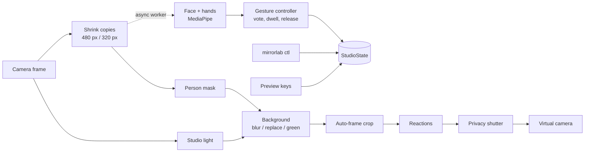

# MirrorLab Studio

> [README](../README.md) · [Español](../README.es.md) · [Architecture](ARCHITECTURE.md) · [Gestures](GESTURES.md) · [Cross-platform notes](CROSS_PLATFORM.md) · [Security](../SECURITY.md)

`mirrorlab cam` reads your camera, applies a few effects, and publishes the result as a
**virtual camera** that any call or streaming app can select. This document explains how it
works, how to set up each platform, what it guarantees about privacy, and how to control it.

- [What it does](#what-it-does)
- [Setting up a virtual camera](#setting-up-a-virtual-camera)
- [Usage](#usage)
- [Settings](#settings)
- [Gesture control](#gesture-control)
- [Controlling a running session](#controlling-a-running-session)
- [Privacy model](#privacy-model)
- [How a frame is processed](#how-a-frame-is-processed)
- [Performance](#performance)
- [Limitations](#limitations)
- [Using the pieces as a library](#using-the-pieces-as-a-library)

---

## What it does

| Feature | What you get |
| --- | --- |
| **Background** | `blur`, `replace` (your image), `green` (chroma key) or `black`. The person mask is smoothed over time so the outline does not shimmer. |
| **Auto-framing** | A smooth virtual pan and zoom that keeps your face in the upper third. It has a deadzone (no reaction to small head movements), a zoom limit, and eases back to the full frame when you leave. |
| **Studio light** | Exposure is metered on your face, not the whole frame, so a bright window behind you does not leave you dark. The correction is smoothed and bounded. |
| **Privacy shutter** | Covers the output on demand, by gesture, or automatically after you leave the frame. |
| **Reactions** | Hand gestures float a small icon (thumbs up, heart, ok) over your picture for the other people on the call. |
| **Gesture control** | Hand poses trigger the actions above, with a per-gesture hold time so accidental poses do not fire. |

Everything runs on the CPU, on your machine. No frame is sent anywhere. The only network
access is the one-time download of the model files (about 12 MB), which you can do by hand
for an offline machine (see [models](#models)).

---

## Setting up a virtual camera

A Python program cannot create a camera device on its own: the operating system needs a
component for that. MirrorLab talks to it through
[pyvirtualcam](https://github.com/letmaik/pyvirtualcam).

> **Licence note.** pyvirtualcam is **GPL-2.0**; MirrorLab is MIT. For that reason it is
> never installed by default. It is the `vcam` extra: `pip install "mirrorlab[vcam]"`.
> MirrorLab does not copy or bundle any of its code, and everything except the final
> "publish to a camera" step works without it (`--output none`). If you redistribute
> a combined build, check what the GPL means for your case; this is not legal advice.

Run `mirrorlab doctor` (or `mirrorlab cam --check`) at any time to see what is missing and
the exact command to fix it.

### Linux

You need the `v4l2loopback` kernel module, which creates a `/dev/videoN` device.

```bash
sudo apt install v4l2loopback-dkms          # Debian / Ubuntu; other distros package it too
sudo modprobe v4l2loopback devices=1 video_nr=10 card_label="MirrorLab" exclusive_caps=1
pip install "mirrorlab[vcam]"
mirrorlab cam --profile meeting --device /dev/video10
```

`exclusive_caps=1` matters: Chrome and Zoom only list a loopback device that sets it.
Loading the module needs root and, with Secure Boot enabled, a signed module.

### macOS

Install [OBS Studio](https://obsproject.com) (version 30 or later), then do this **once**:
open OBS, click *Start Virtual Camera*, click *Stop Virtual Camera*, and quit OBS. After that:

```bash
pip install "mirrorlab[vcam]"
mirrorlab cam --profile meeting
```

Only one program can own OBS's virtual camera at a time, so close OBS while MirrorLab runs.
Your terminal needs camera permission (System Settings → Privacy & Security → Camera).

### Windows

Install [OBS Studio](https://obsproject.com); its installer registers the *OBS Virtual
Camera*. Then:

```powershell
pip install "mirrorlab[vcam]"
mirrorlab cam --profile meeting
```

As on macOS, do not run OBS's own virtual camera at the same time.

### Try it without any of this

```bash
mirrorlab cam --output none --preview --profile meeting
```

shows the result in a local window and publishes nothing.

---

## Usage

```bash
mirrorlab cam --profile meeting                      # blur + auto-frame + studio light
mirrorlab cam --background replace --bg-image office.jpg
mirrorlab cam --background green --studio-light      # for OBS / chroma key
mirrorlab cam --privacy-on-start                     # start covered; a palm opens it
mirrorlab cam --away-after 10                        # cover after 10 s with nobody in frame
mirrorlab cam --no-gestures                          # skip hand tracking (saves CPU)
mirrorlab cam --preview                              # also show a local window
mirrorlab cam --input recording.mp4 --output none --report   # reproducible run
```

Exit codes: `0` ok, `1` check failed, `2` bad settings, `3` camera error, `4` output error.

In `--preview`, keys are: `q` quit, `p` privacy, `b` next background, `f` framing,
`l` light, `s` snapshot, `t` thumbs-up reaction, `h` heart.

### Models

The first run downloads the person-segmentation model (0.25 MB) and the face and hand
models (about 11 MB) to your cache directory. For an offline machine, copy the files into
`~/.cache/mirrorlab/models` (Linux), `~/Library/Caches/mirrorlab/models` (macOS) or
`%LOCALAPPDATA%\mirrorlab\models` (Windows), or point `MIRRORLAB_MODELS` at a folder.
`mirrorlab models --status` lists what is present.

---

## Settings

Settings come from four layers, lowest priority first: the defaults, a **profile**, a
`studio.json` / `studio.yaml` file (in the current directory or `~/.config/mirrorlab`), and
command-line flags. An unknown key is an error, never silently ignored.

Built-in profiles: `meeting`, `stream`, `privacy`, `clean`. Define your own in the file:

```json
{
  "blur_strength": 61,
  "away_after": 8,
  "bindings": { "open_palm": "privacy", "peace": "background_next", "thumbs_up": "reaction:love" },
  "dwell":    { "open_palm": 2.0 },
  "profiles": {
    "podcast": { "background": "green", "studio_light": true, "auto_frame": true }
  }
}
```

| Key | Default | Meaning |
| --- | --- | --- |
| `width`, `height`, `fps` | `1280`, `720`, `30` | Output size and rate. Both sizes must be even. |
| `perception_fps` | `10` | Face and hand detections per second (`0` = unlimited). Gestures and framing need little more, and unlimited detection competes with the video path for CPU. |
| `analysis_width` | `480` | Width of the copy the face and hand detectors see. Landmarks are normalised, so this changes cost, not geometry. |
| `segmentation_width` | `320` | Width of the copy the person segmenter sees (its model works at 256 px). |
| `background` | `off` | `off`, `blur`, `replace`, `green`, `black`. |
| `blur_strength` | `51` | Blur kernel in full-resolution pixels (3-201). |
| `background_image` | `""` | Image for `replace`. Without a readable image, `replace` becomes `blur` and logs a warning. |
| `mask_smoothing` | `0.55` | Temporal smoothing of the person mask, `0` (off) to `<1`. |
| `auto_frame` | `false` | Enable auto-framing. |
| `max_zoom` | `1.8` | Largest zoom auto-framing may use. |
| `studio_light` | `false` | Enable face-metered exposure. |
| `light_strength` | `0.6` | How far to correct toward the target exposure, `0`-`1`. |
| `privacy_mode` | `card` | What the shutter shows: `card` (text on a dark card), `black`, `blur`. |
| `away_text` | `Be right back` | Text on the `card`. |
| `away_after` | `0` | Cover the camera after this many seconds with no face. `0` disables. |
| `privacy_on_start` | `false` | Start with the shutter closed. |
| `gesture_control` | `true` | Track hands and act on gestures. Turning it off skips hand detection. |
| `reactions` | `true` | Allow reaction icons. |
| `bindings` | see below | Gesture → action. |
| `dwell` | see below | Seconds to hold each gesture before it fires. |

---

## Gesture control

Gesture recognition is the same geometric engine as the rest of MirrorLab
([GESTURES.md](GESTURES.md)): 21 hand landmarks, explainable rules, no trained classifier.
What the studio adds is a **safe trigger**. A pose must win a majority vote over the last
frames, then be held for its dwell time, and then fires once; you must release the pose
before it can fire again.

Default bindings:

| Gesture | Action | Hold | Why this pose |
| --- | --- | --- | --- |
| Open palm | `privacy` (toggle) | 1.6 s | A flat palm is a natural "stop"; the long hold is because people show their palm by accident while talking. |
| Peace sign | `background_next` | 1.0 s | Cycles the usable backgrounds. |
| Thumbs up | `reaction:thumbs_up` | 0.6 s | |
| I-love-you | `reaction:love` | 0.6 s | |
| OK | `reaction:ok` | 0.6 s | |

In `--preview` a ring fills while you hold a pose, so you can see that you were recognised.
The ring is drawn only in the preview window, never in the published video.

### Actions

| Action | Effect |
| --- | --- |
| `privacy`, `privacy:on`, `privacy:off` | Toggle or set the shutter. |
| `background:MODE` | `off`, `blur`, `replace`, `green`, `black`. |
| `background_next` | Cycle `off` → `blur` → (`replace` if an image is loaded). |
| `framing`, `framing:on/off` | Auto-framing. |
| `light`, `light:on/off` | Studio light. |
| `reaction:NAME` | `love`, `heart`, `thumbs_up`, `ok`, `star`. |
| `snapshot` | Save a PNG of the output to `captures/`. |
| `noop` | Do nothing (use it to unbind a gesture). |

---

## Controlling a running session

While `mirrorlab cam` runs, another terminal can drive it:

```bash
mirrorlab ctl status
mirrorlab ctl privacy            # toggle    (privacy on / privacy off to set)
mirrorlab ctl background blur
mirrorlab ctl next-background
mirrorlab ctl framing off
mirrorlab ctl react love
mirrorlab ctl snapshot
mirrorlab ctl quit
```

This is meant for hotkeys: bind `mirrorlab ctl privacy` to a key in your window manager,
Stream Deck, Hammerspoon or AutoHotkey.

### Protocol

The session listens on `127.0.0.1` on a random port and writes
`{"host", "port", "token", "pid"}` to a file readable only by you:

| OS | Path |
| --- | --- |
| Linux | `$XDG_RUNTIME_DIR/mirrorlab/control.json` (else `<temp dir>/mirrorlab-UID/control.json`) |
| macOS | `<temp dir>/mirrorlab-UID/control.json` (`$TMPDIR`, a per-user folder) |
| Windows | `%LOCALAPPDATA%\mirrorlab\control.json` |

Override with `MIRRORLAB_RUNTIME_DIR`. One JSON object per line, one request per connection:

```json
{"token": "…", "cmd": "status"}
{"token": "…", "cmd": "action", "action": "background:blur"}
{"token": "…", "cmd": "quit"}
```

Replies are `{"ok": true, ...}` or `{"ok": false, "error": "…"}`. The channel can only apply
the actions above, report status, and stop the session. See the
[privacy model](#privacy-model) for how it is protected.

---

## Privacy model

These are properties the code is written and tested to keep. If one stops holding, that is
a bug and belongs in a [security report](../SECURITY.md).

1. **Nothing leaves the machine.** The studio opens no outbound connection. Models download
   once, over HTTPS, from the URLs in `src/mirrorlab/detectors/models.py`.
2. **Background effects fail closed.** If the person mask is unavailable (model missing,
   inference error), the *whole frame* is blurred; the real room is never passed through
   while you believe it is hidden. `mirrorlab cam --report` counts these frames.
3. **A closed shutter shows no camera pixels** in the default `card` mode and in `black`
   mode. The cover is built from scratch rather than blended over the frame; the only moment
   the two mix is the 0.25 s fade. While fully closed, the output does not depend on the
   camera at all (there is a test for that). `privacy_mode: blur` is the exception by design:
   it shows a very heavy blur of the camera, which hides detail but not the presence of a person.
4. **A lost camera never freezes on the last picture.** If frames stop for 1.5 s, the output
   becomes the cover while the session tries to reopen the camera.
5. **Manual and automatic closes are independent.** The away detector can cover the camera,
   but never reopens a shutter you closed yourself.
6. **The control channel is local and authenticated.** Loopback only, a 192-bit random token
   in a `0600` file (directory `0700`), constant-time comparison, a line protocol that a
   web page cannot speak (an HTTP request fails to parse), 4 KiB request limit, 2 s read
   timeout, and a fixed set of actions.

Not covered: another process running as you can read the token file and control the session;
that is the same trust level as being able to read your webcam directly.

---

## How a frame is processed



- **Perception is asynchronous.** Hand detection can cost ~100 ms on a laptop CPU when no
  hand is tracked. Running it inline would make a 30 fps stream hitch, so it runs on a worker
  thread (`studio/perception.py`) that always takes the newest frame and drops the ones it
  missed. Detections are therefore a few frames old, which is invisible for framing, light and
  gestures. The person mask is *not* asynchronous, because it has to line up with the pixels.
- **The order is deliberate.** Light is applied before the background so a replacement image
  is not re-exposed; framing is applied after, so a virtual background is cropped with you;
  the shutter is last so nothing can be drawn on top of the cover.
- **The output rate is steady.** Call apps treat a virtual camera that stops sending as a
  frozen camera, so the session sends at the target rate and repeats the last output when
  the camera is slower than that.

Code map (`src/mirrorlab/studio/`):

| File | Responsibility |
| --- | --- |
| `settings.py` | Validated, immutable settings; profiles; file discovery. |
| `state.py` | Mutable runtime state and the action vocabulary. |
| `pipeline.py` | One frame in, one frame out. Takes its detectors as arguments. |
| `background.py`, `framing.py`, `light.py`, `privacy.py`, `reactions.py` | The effects. Pure NumPy/OpenCV. |
| `perception.py` | Async wrapper that moves detection off the video path. |
| `vcam.py` | Output sinks and the platform readiness probe. |
| `control.py` | The local control server and client. |
| `session.py` | The loop: capture, pacing, stall handling, shutdown, latency stats. |
| `cli.py` | `mirrorlab cam` and `mirrorlab ctl`. |

---

## Performance

Measure on your own machine with a fixed input so runs are comparable:

```bash
mirrorlab cam --input tests/assets/portrait.jpg --output none \
    --profile meeting --no-control --max-frames 300 --report
```

The report gives p50 and p95 time per stage. Reference numbers on an AMD Ryzen 7 5700U
laptop (8 cores, 16 threads, Linux, Python 3.12), 1280x720 output, `meeting` profile:

| Configuration | Output rate | `total` p50 / p95 | `background` p50 |
| --- | --- | --- | --- |
| `--profile meeting` (blur, auto-frame, light, gestures on) | 29.9 fps | 23.1 ms / 28.7-32.5 ms | 17.7-18.6 ms |
| `--profile meeting --no-gestures` | 29.9 fps | 22.9 ms / 28.9 ms | 17.4 ms |
| `--profile clean` (passthrough, gestures off) | 30.0 fps | 2.7 ms / 3.6-4.1 ms | n/a |

Three runs of 400 frames each, on a `portrait.jpg` input. These were taken on a laptop
that was also running a desktop, a browser and an editor (load average 3-5), so treat them as
a realistic, not a best-case, figure; run-to-run noise was about 10%. The 30 fps budget is
33 ms per frame, and `total` p95 stays under it. A first, unoptimised version of this
pipeline took 65 ms per frame; the three changes that fixed it were running detection on
a worker thread at a capped rate, segmenting a 320 px copy instead of full resolution, and
blurring the background at a quarter of the resolution.

What costs what, and what to turn down:

| If it is slow | Do this |
| --- | --- |
| High `background` | Lower `segmentation_width` (256 is the model's native size); lower `blur_strength`. |
| Camera reports fewer fps than you asked for | Webcams drop their rate in dim light. Brighten the room, or set `--fps` to what the camera delivers. |
| High CPU with an idle picture | `--no-gestures` skips hand detection, the most expensive detector. |
| Hitches | Close other CPU-heavy programs; check that the report's `total p95` is under 33 ms for 30 fps. |

---

## Limitations

- **Windows and macOS need OBS installed** to provide the virtual camera device.
  This is a limit of pyvirtualcam, not something MirrorLab can remove.
- **The virtual camera path has been exercised through mocks and through the
  `--output none` path with a real camera, but not on a machine with `v4l2loopback`
  or OBS in the continuous integration.** If it fails on your setup, `mirrorlab doctor`
  and an issue with its output are the fastest route to a fix.
- **Mask quality is that of a small model.** MediaPipe's selfie segmenter is fast and
  good for a head-and-shoulders view; it is not a professional matting model. Hair and
  fast hand movements near the edge can show a halo.
- **Auto-framing is a digital crop.** Zooming in loses resolution; `max_zoom` bounds it.
- **No audio.** Microphone noise suppression is a different problem and is out of scope.
- **Gestures need a visible hand** and reasonable light. Hand detection is the heaviest
  step; on weak CPUs use `--no-gestures` and the `ctl` command or the preview keys instead.

---

## Using the pieces as a library

```python
from mirrorlab.studio import StudioSettings, StudioPipeline

settings = StudioSettings.load(profile="meeting")
pipeline = StudioPipeline(settings)               # effects only; pass perception=/segmenter= for the rest
result = pipeline.process(frame_bgr)
publish(result.output)                            # BGR uint8, settings.width x settings.height
```

Each effect is also usable alone: `BackgroundProcessor`, `AutoFramer`, `StudioLight`,
`PrivacyShutter`, `ReactionStage`. They take NumPy arrays and a timestamp, and have no
dependency on the camera or on MediaPipe.
